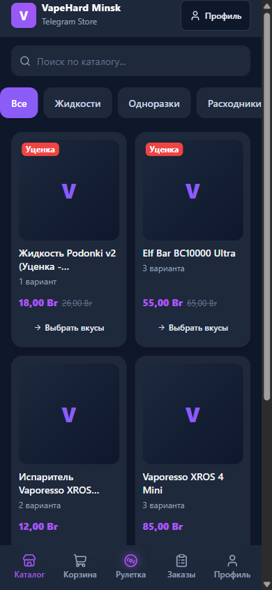
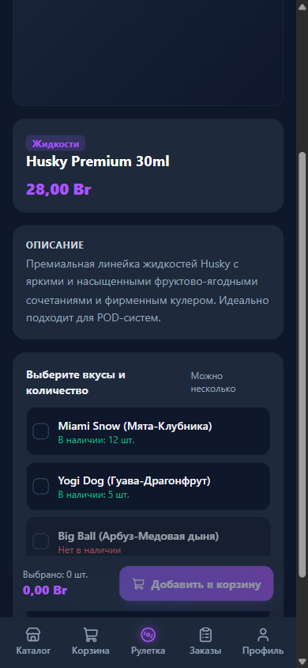
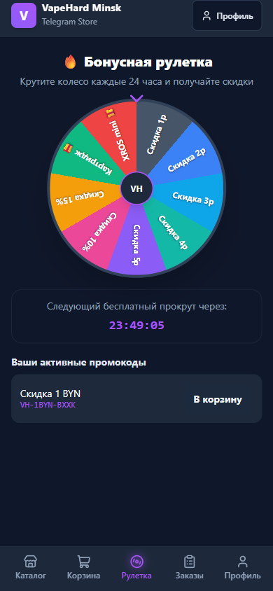
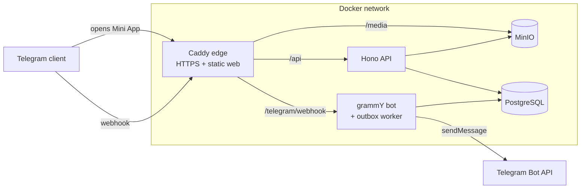

<div align="center">

# VapeHard Minsk

**A full-stack shop that runs inside Telegram: a Mini App + a bot.**

Customers browse the catalog, build a cart, spin a bonus roulette and place an order without leaving Telegram.
Admins manage products, stock, orders and finances in the same app.






</div>

## Features

**For customers**

- Catalog opens right away: search, category filters, discounted items.
- Product page with several flavours/variants and quantities in one go.
- Cart with promo codes and delivery options; the server recalculates every price.
- Bonus roulette: one free spin every 24 hours, the prize becomes a promo code.
- Order history and status updates from the bot.
- Login through Telegram: no passwords or sign-up for customers.

**For admins**

- Admin panel behind a password (or permanent admin Telegram IDs).
- Products and variants with image upload, stock management.
- Orders with a status workflow; cancelling an order returns stock.
- Finance overview and roulette odds settings.
- New-order notifications to the manager's Telegram chat.

## Engineering highlights

- **No overselling.** Stock is reduced in one database transaction with a conditional update (`stock >= qty`), so two parallel orders cannot buy the last item. A test fires parallel orders to check this.
- **Server is the source of truth.** Prices, discounts, stock, roles and promo validity are computed on the server. The client only displays them.
- **Secure Telegram auth.** Each request carries Telegram `initData`; the API checks its HMAC-SHA256 signature with the bot token and its age.
- **Idempotent checkout.** An `Idempotency-Key` header makes a repeated "Place order" tap return the same order instead of creating two.
- **Outbox pattern.** The API never calls Telegram directly. It writes messages to an `OutboxMessage` table in the same transaction, and the bot worker delivers them with retries.
- **Fair roulette.** Server-side `crypto.randomInt`, cooldown enforced under a row lock (`SELECT … FOR UPDATE`).
- **Money as integers.** All amounts are stored in kopecks, never floats.
- **End-to-end types.** The web client uses Hono RPC, so API types flow to the frontend without code generation.
- **Small bundle.** Lazy routes, and admin code is in separate chunks. The build checks a 250 KB gzip budget and scans the bundle for leaked secrets.

## Tech stack

| Layer    | Tools                                                                        |
| -------- | ---------------------------------------------------------------------------- |
| Frontend | React 19, Vite, React Router, TanStack Query, Tailwind CSS v4, Telegram SDK  |
| Backend  | Node.js, Hono, zod, Prisma 7, PostgreSQL, pino                               |
| Bot      | grammY (webhook in prod, polling in dev), outbox worker                      |
| Storage  | MinIO (S3-compatible) with presigned uploads                                 |
| Infra    | Docker Compose, Caddy (automatic HTTPS, security headers)                    |
| Tooling  | pnpm workspaces, Turborepo, ESLint, Prettier, Vitest, MSW, Husky, commitlint |

## Architecture



```
apps/
  api/      Hono REST API: routes → services → Prisma
  bot/      grammY bot and outbox worker
  web/      React Mini App (feature folders)
packages/
  shared/   zod schemas, DTOs, pure domain logic (pricing, statuses, roulette)
  db/       Prisma schema, migrations, seed
  config/   shared tsconfig / eslint / prettier
docker/     Dockerfiles and Caddyfile
docs/       plan, assumptions, ADRs, deployment guide
```

## Getting started

Requirements: Node.js 22+, pnpm (`corepack enable pnpm`), Docker.

```bash
pnpm install
cp .env.example .env                       # fill BOT_TOKEN, ADMIN_PASSWORD, MANAGER_*
pnpm db:up                                 # PostgreSQL + MinIO in Docker
pnpm --filter @vapehard/db migrate:deploy
pnpm --filter @vapehard/db seed            # sample categories, products, prizes
pnpm dev                                   # api :3000, bot, web :5173
```

Open http://localhost:5173. In development the app imitates Telegram: the Vite dev server signs test `initData` on the server side, so you can use the shop in a normal browser. To open the admin panel, go to **Profile → Admin login** and enter `ADMIN_PASSWORD`.

To try it inside Telegram, expose the dev server over HTTPS (`cloudflared tunnel --url http://localhost:5173`) and set the URL as the bot's Mini App URL.

## Scripts

```bash
pnpm lint        # ESLint, zero warnings
pnpm typecheck
pnpm test        # unit + integration tests (needs `pnpm db:up`)
pnpm build       # production build + bundle budget check
```

## Documentation

- [Deployment and operations](docs/DEPLOY.md): Docker, VPS, BotFather, environment variables, backups, troubleshooting.
- [Architecture decisions (ADR)](docs/adr)
- [Plan](docs/PLAN.md) · [Assumptions](docs/ASSUMPTIONS.md) · [Progress](docs/PROGRESS.md)

## Legal note

This shop sells nicotine products. Before going live, the owner must check local laws on selling and advertising them, age verification, and Telegram's rules. The "I am 18+" checkbox at checkout is a confirmation, not a legal age check.
